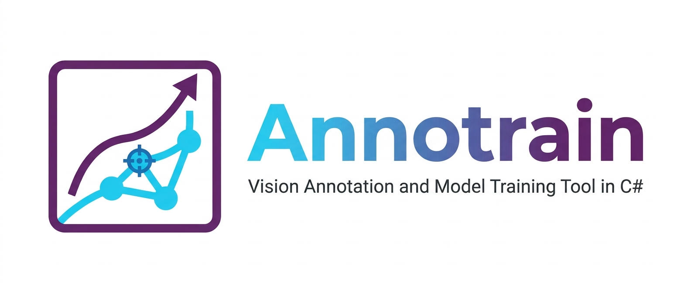

<p align="center">
  
</p>

# Annotrain

面向 **YOLOv8 / YOLO11 / RF-DETR** 的「标注 → 训练 → 检测验证」工作台，纯 C#，不依赖 Python 运行时。

> 定位：个人 / 小团队自用的模型迭代工具。
> 检测只用于验证训练出来的模型效果，**不作为对外推理服务，也不作为供其他系统集成的 SDK**。

仓库用**两个解决方案**分别管两条线，互不编译依赖，只共享 `Sevencat.Core`：

| 解决方案 | 产出 | 组成 |
| --- | --- | --- |
| `Sevencat.Label.sln` | 标注桌面应用 `Sevencat.Label.App.exe` | 业务 + 程序 + Web |
| `Sevencat.Train.sln` | 训练/验证桌面应用 `Sevencat.Train.exe` | 业务 + 引擎 + Web |

## 技术路线

- **纯 C# 训练**：TorchSharp（LibTorch）承担计算；训练循环、EMA、损失、数据增强、ONNX 导出全在进程内，不用 Python。
- **代码复用**，不重写：
  - 标注参考 `F:\code\TinyLabel\src`（画布 `AnnotationCanvas`、标注模型、原子写盘、Minimal API 服务）；
  - 训练参考 `F:\code\OmniTensorSharp`（YOLO/RF-DETR 网络、Trainer、导出、推理）。
  - 能复制的直接复制，只做命名空间改名与**存储层接口化**。
- **存储必须抽象**：YOLO / COCO / RF-DETR 的目录探测、标注读写、数据集读取全部收敛到接口；画布与训练器都不认识具体格式。
- **标注端与训练端共用一套存储**：图片、标注、描述文件都走同一个 `IBlobStore`（`file://` / 将来 `s3://`），
  除本地实现外代码里不出现 `File.*` / `Directory.*`。

支持的数据集形态（与后端正交，均可用 `file://` 或 `s3://`）：

| 形态 | 图片 | 标注 | 说明 |
| --- | --- | --- | --- |
| YOLO | `images/{split}` | `labels/{split}/*.txt` | `data.yaml` 描述 |
| COCO / RF-DETR | `train/valid/test` | `{split}/_annotations.coco.json` | 兼容 annotations/instances |
| TinyLabel 目录+DB | 项目目录 / 扫描根 | SQLite `annotations` 表 | DB 需本地，图片可远端；train/val 用 `images.Split` 字段 |
| 平铺 | 任意目录 | 同名 `.json` / `.txt` | `classes.txt` |
| VOC | `JPEGImages/` | `Annotations/*.xml` | 仅识别与只读浏览，编辑暂不实现 |

打开目录时自动探测格式，检测结果记在项目记录里（`Format` / `DescriptorPath`），下次直接打开。

## 解决方案结构

```text
Sevencat.Label.sln
  src/Sevencat.Core/              跨解决方案契约：存储接口、公共模型、坐标与图像抽象、格式 codec
  src/Sevencat.Label/             标注业务：标注入库、编辑器逻辑、原子写盘
  src/Sevencat.Label.App/         标注程序（exe）：画布、交互、ViewModel、窗口
  src/Sevencat.Label.Web/         标注 Web：Minimal API + 内嵌页面 + 数据集统计
  tests/Sevencat.Label.Tests/     格式读写、坐标换算、目录探测

Sevencat.Train.sln
  src/Sevencat.Core/              （同一份源码，两个解决方案都包含）
  src/Sevencat.Train.App/         训练程序（exe）：任务队列、参数、日志、检测验证页
  src/Sevencat.Train.Engine/      训练引擎：模型结构、数据管线、Trainer、导出、推理
  src/Sevencat.Train.Web/         训练 Web：任务列表、实时日志、指标
  tests/Sevencat.Train.Engine.Tests/  模型结构、损失、导出、数据集接口
```

命名约定：

- `Sevencat.<模块>` 是业务层。`Sevencat.Core`、`Sevencat.Train.Engine`、`Sevencat.Label` **不得引用 Avalonia**。
- 可执行程序统一叫 `Sevencat.<模块>.App`：`Sevencat.Label.App`、`Sevencat.Train.App`；它们可以引用 Avalonia。
- Web 项目都是类库，由各自程序进程内启动 HTTP 服务，随主程序启停，不单独部署。
- 检测（推理验证）不单独建项目：推理在 `Sevencat.Train.Engine`，页面在 `Sevencat.Train.App`。

## 快速开始

```powershell
# 标注（数据集浏览 / 标注）
dotnet build Sevencat.Label.sln
dotnet run --project src/Sevencat.Label.App

# 训练（训练 / 检测验证）
dotnet build Sevencat.Train.sln
dotnet run --project src/Sevencat.Train.App

# 测试
dotnet test Sevencat.Label.sln
dotnet test Sevencat.Train.sln
```

配置文件与日志位于 `%APPDATA%\Sevencat.Annotrain\`（`settings.json`、`logs\`）。

## 当前状态

M0（骨架）已完成：两个解决方案各 5 个项目，Avalonia 12.1.5 + Material.Avalonia 3.21.0 主题已接入，
DI / 配置 / 日志（NLog 按天落盘 + 界面日志面板）可用，两个桌面应用可启动。

M1（存储抽象）进行中：`IBlobStore`（本地后端 + 按 scheme 的注册表）、YOLO / LabelMe / COCO codec、
五种形态的格式探测、yolo / coco / flat 的 Provider 与统一打开入口 `DatasetStoreResolver` 已完成并有单测；
`tinylabel`（目录 + SQLite）形态、形态转换、项目表落库还没做。

应用图标在 `assets/app.ico`（由 `docs/image_ico.png` 生成，含 16–256 多尺寸），两个 exe 与窗口都用它。

## 文档索引

- [需求](docs/REQUIREMENTS.md)
- [计划](docs/PLAN.md)
- [进度](docs/PROGRESS.md)
- [杂项](docs/MISC.md)

## 作者

<p align="center">
  
</p>

## 许可

MIT，见 [LICENSE](LICENSE)。
